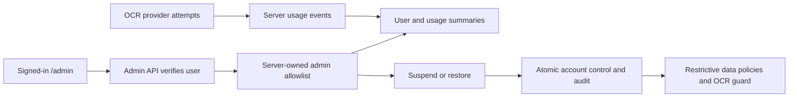
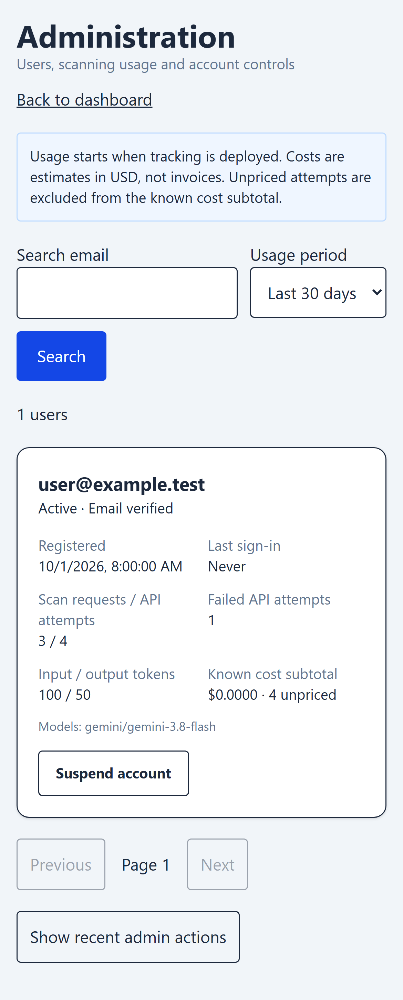

# Admin console

## Contract

Before: no user administration or per-account scan cost history.
After: protected admin route in the existing repo, searchable/paginated users, registration/last-sign-in/verification status, 7/30/90-day usage, suspend/restore confirmation, and last 50 admin actions. Shared backend and release ownership make a separate repo unnecessary for this initial version.

## Boundaries

- Every admin request verifies a real Auth user and a database allowlist. Client metadata cannot grant admin access. No admin is created automatically; an operator grants a selected existing account.
- Suspension is immediate for database access and new OCR requests, including existing JWTs, through restrictive RLS and a server guard. Password sign-in itself remains available. Data stays intact. Already downloaded/cached data and in-flight scans cannot be recalled.
- Self/admin suspension is rejected. Every successful state change writes an audit record in the same transaction. Hard deletion and email/password changes are deferred.
- Usage is captured only by the OCR server, not trusted browser counters. A Gemini attempt and Vision fallback share a request ID but are recorded separately. Errors and unknown token counts remain visible. Outcome means provider response success, not whether OCR rows were usable.
- Tracking starts on deployment. Historical usage cannot be reconstructed from existing entries. Events contain no images, extracted text, credentials, or passwords.
- Costs are estimated USD subtotals. The verified standard paid Gemini 3.8 Flash rates are seeded at $0.75 input and $3.75 output per million tokens (including thinking), valid through December 31, 2026. The rate expires automatically on January 1, 2027; update it before then. Vision and failed/unknown usage remain unpriced until verified rates/usage are available. Cost snapshots are preserved on each event; rate changes do not rewrite history. Free tiers, caching discounts, pricing tiers, and actual invoices are not reconciled by this initial gross standard-price estimator. [Google pricing](https://ai.google.dev/gemini-api/docs/pricing)
- A recording error is logged by code only and does not discard a successful OCR response; monitor these errors before relying on totals. An account-control lookup failure blocks scanning instead of bypassing suspension.

## Rollout and review

1. Apply only `20261010090000_admin_usage.sql`; do not replay older migrations.
2. Grant the chosen existing user by inserting their Auth ID into `public.app_admins` through an authorized operator SQL session. Confirm the account email with the owner first. Never expose service-role keys in Vercel/frontend configuration.
3. Deploy `admin-api` (JWT verification enabled) and updated `ocr-scanner` after the migration.
4. Deploy frontend; visit `/admin`, verify non-admin denial, review user search and a controlled suspend/restore, then check real scan usage. This backend does not need SMTP.
5. Review/merge automated-test PR #7 before this PR so the admin browser cases run under the common feature harness.

Tests: `node --test tests/admin-api.test.mjs` covers unauthenticated/non-admin denial, bounded filters, token-owned actor, self-suspension and fail-closed errors. Browser tests use synthetic data; local SQL checks validate allowlist privileges, immediate suspension, audit atomicity, and usage summaries. Production rollout is pending owner admin-account selection and review.

Grounding: repository Auth/RLS/OCR paths and [Supabase server-side admin APIs](https://supabase.com/docs/reference/javascript/auth-admin-updateuserbyid). The console uses platform Auth records; application access controls remain database-owned.

## Verification

- Six admin/usage Node checks passed.
- Four built-app browser cases passed (desktop/phone access denial and suspend/cancel/restore flow).
- Local transaction tests passed for private table/RPC privileges, immediate reads/writes blocked on suspension, restoration, atomic audit, duplicate prevention, cost arithmetic, and unpriced summaries. Test data was rolled back.
- Production build and both Edge Function Deno type checks passed. Lint has zero errors and two existing App hook warnings.
- Production backend/admin access is not deployed or verified.

Synthetic-data phone preview:

