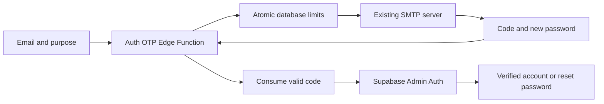
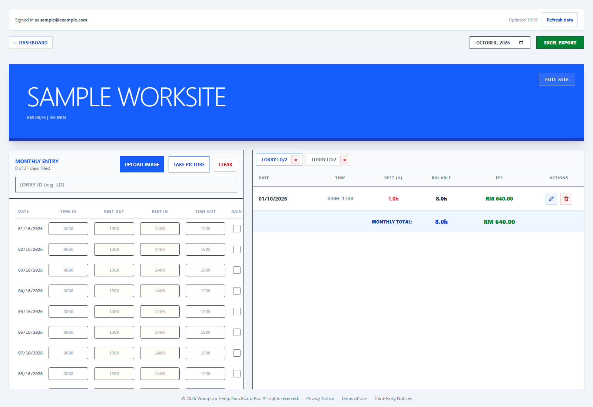
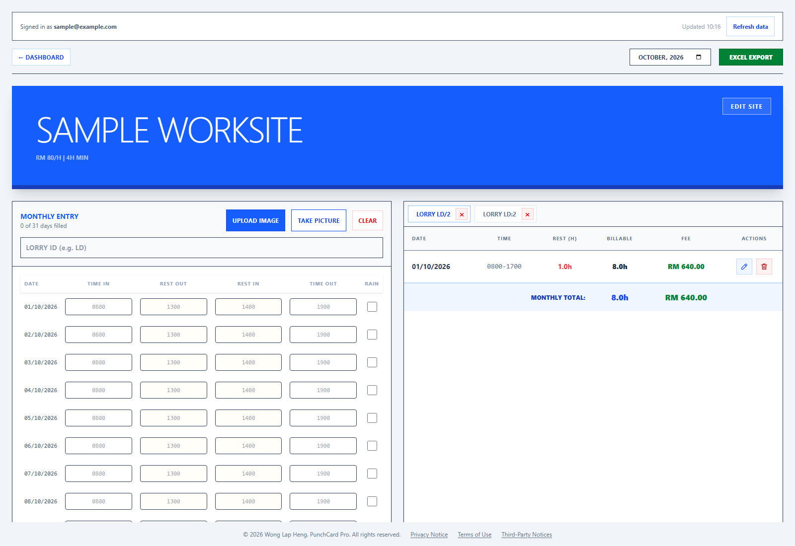
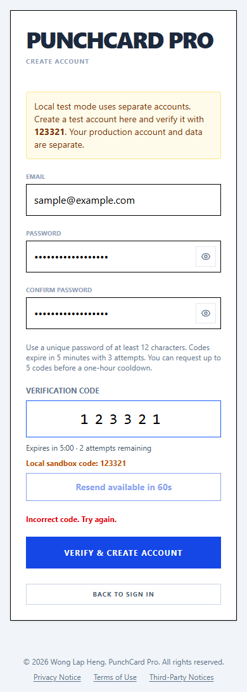
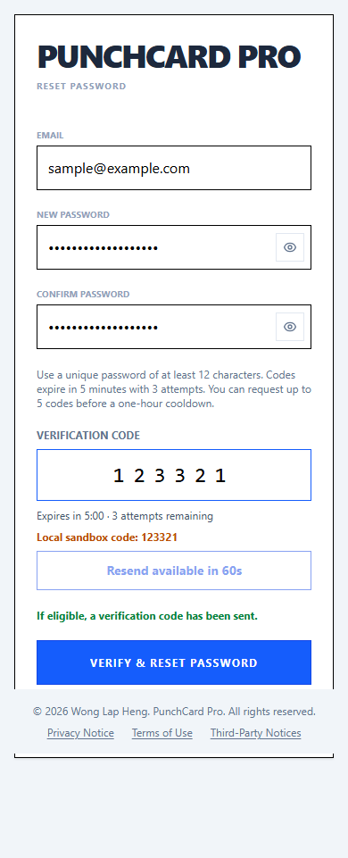

# Export, account verification, and equal panels

## Contract



The browser can request and submit a code. Only the server can issue, compare, or consume it and create a verified account. The database serializes guesses and requests across tabs/devices. Direct native signup must be disabled when this endpoint goes live; Admin Auth still creates verified users.

## Export diagnosis

The reported time was interpreted as **8 October 2026, 5:44 pm Malaysia time (09:44 UTC)**. Vercel rejected the historical runtime-log query because the project's Hobby retention does not cover that time. This is unavailable evidence, not a clean log result. Export executes entirely in the browser, so its thrown errors do not ordinarily reach Vercel runtime logs.

The old handler used each lorry ID verbatim as an Excel worksheet name. The installed SheetJS library rejects `: \ / ? * [ ]` and names longer than 31 characters. A read-only production aggregate found **26 of 186 entries with invalid worksheet-name characters**, with no overlong IDs. The error was reproduced locally with `LD/2`. This is a strong causal explanation, but cannot establish which record triggered the historical incident.

The old handler also threw `Workbook is empty` for a month with no saved entries. Browser download restrictions, especially on phones, remain another possible cause of a generated file not being saved.

The fix sanitizes/truncates sheet names and resolves collisions without changing the lorry ID written inside the sheet. Empty-month export is disabled. Failures appear in the UI, and every successful generation leaves a direct download link to use when an automatic download is blocked. Export fees sum the recorded ledger fees so they agree with the ledger even after rate changes.

The successful-export message appears as a notification at the top right, with a close button and the direct download link. It fits phone widths and reappears on the next export after dismissal.

## OTP policy and added safeguards

- Codes expire after 300 seconds and allow 3 guesses, enforced atomically in PostgreSQL.
- A code is consumed on success or after the third wrong guess. Resending invalidates the previous code for that purpose.
- An email can request 5 codes in a one-hour window, shared across registration/recovery. After the fifth issuance, new requests pause for one hour; that fifth code can still be verified for its five-minute lifetime.
- Resends require 60 seconds; an IP can request 20 codes per hour. The function uses the gateway's final `X-Forwarded-For` address, falling back to a shared limited bucket if absent. Preserve gateway header rewriting if adding a proxy.
- The freeze affects code requests only. Existing password sign-in remains available.
- Codes and email/IP keys are HMAC-hashed with a server key; passwords and plaintext codes are never stored in the OTP tables or application logs. Old challenge rows are removed after a day, and inactive counters after two days, during issuance.
- Recovery responses do not reveal whether an email is registered. SMTP failures use a generic error.
- New/reset passwords require 12–128 characters. Reset revokes all refresh sessions; already-issued access tokens can remain valid until their expiry (currently one hour).
- The endpoint restricts browser origins, uses TLS for SMTP, and has no public table access or publicly callable privileged RPCs.

## Local manual test

Local sandbox Auth is isolated from production. Its code is always **123321**. The server enables this only when its Supabase URL is local HTTP (`localhost`, `127.0.0.1`, or local Docker `kong`); a request or frontend flag cannot enable it on hosted Supabase.

Production credentials do not sign in to the local database. Create a separate local test account first; the sign-in screen explains this in local mode.

Saved data is fetched on sign-in/page reload and after local saves. The Refresh data controls, update timestamp, interval polling, and focus/visibility/online refresh listeners have been removed. To see another device's latest saved data, reload the page. A small account label remains to identify the signed-in account.

With Docker Desktop running:

```powershell
npx supabase start
npx supabase migration up --local
npm run sandbox:setup
npx supabase functions serve auth-otp
# In another terminal:
npm run dev:sandbox
```

`sandbox:setup` writes only the local URL and local anon key into ignored `.env.sandbox.local`. No production account or data is affected. Registration creates a real user in local Supabase, then allows ordinary password sign-in. Password recovery also uses a real local user.

1. Create an account with a test email and a password of at least 12 characters. Try two incorrect codes, then `123321`. The account should become usable only after verification.
2. Try three wrong codes on a fresh email. A correct code must then fail; wait for resend or use a different test email.
3. Use Forgot password, request a code, enter `123321`, and choose a new password. The old password must fail and the new one must sign in.
4. Add a site and entries with lorry IDs such as `LD/2` and `LD:2`. Export should download a readable workbook with distinct sheet names and original IDs inside each sheet.
5. At desktop width (1280px or wider), input and ledger columns should have equal widths. Phone tabs remain available.

Automated checks: `npm run test:fixes`, `npm run build`, `npm run lint`. With the local backend running, `npm run test:auth:sandbox` exercises real SQL/Auth and removes its synthetic users. With Vite running on port 5173, `npm run test:ui:fixes` checks browser downloads, equal widths, and auth screens using sample data/mocked auth responses.

Verified on this branch:

- Six export/handler regression tests passed, as did build, lint (two pre-existing hook warnings), and the Deno Edge Function type check.
- The browser downloaded a readable workbook for colliding invalid lorry IDs; the direct fallback link also downloaded it. Empty-month export was disabled, desktop columns measured equal, and phone layout had no page overflow.
- Real local SQL checks passed for five-minute expiry, three guesses, reuse, resend invalidation, the five-code cooldown, IP cap, and table/RPC privileges.
- Real local Auth checks passed for signup after two mistakes, three concurrent wrong guesses exhausting a code, no unverified account, no direct native signup bypass, recovery, old-password rejection, new-password sign-in, and revocation of the old refresh session.
- A phone browser registered using `123321` and signed in to the actual local app with no auth mocks.
- A browser check confirmed page reload reads newly saved remote entries, while focus/online/visibility events and 31 seconds of elapsed time do not fetch data. Refresh controls are absent.

Real production SMTP delivery remains a rollout verification item. Local Auth ran v2.188.1 while hosted Auth reported v2.197.0; check the deployed Auth configuration and real email flow during rollout.

## Required rollout after review

The PR includes backend code/configuration that a Vercel Git deployment alone will not install.

1. Apply only migration `20261010020425_auth_otp_guards.sql` through the normal migration route. Inspect migration history first; do not replay the old wipe migration against production.
2. Configure `AUTH_SMTP_HOST`, `AUTH_SMTP_PORT`, `AUTH_SMTP_USER`, `AUTH_SMTP_PASS`, and `AUTH_SMTP_FROM` as Edge Function secrets using the **existing Supabase SMTP server**. SMTP settings in Supabase Auth are not automatically available to Edge Functions. Do not put credentials in frontend variables, source files, or PR comments.
3. Set `AUTH_ALLOWED_ORIGINS` to the production URL plus intended preview/local test origins. Use exact origins, separated by commas.
4. Deploy `auth-otp` with JWT verification disabled; it serves users before login and enforces its own limits. It uses the server's injected service role key.
5. Disable direct public signup in hosted Supabase Auth using the global **Allow new users to sign up** setting. Keep the **email provider enabled** so existing password sign-in continues to work. Enable email confirmations, set password minimum to 12 and native email OTP expiry to 300 seconds. These local `config.toml` changes do not automatically update hosted Auth. Disabling public signup does not disable Admin Auth creation.
6. Deploy the reviewed frontend and test real SMTP delivery, signup, and recovery with a controlled email address before announcing availability. Keep the old frontend live until the backend is ready.

The requested branch/PR does not change production configuration or deploy this backend before review.

## UI proof

Captured at 1600px desktop width and 390px phone width using sample data. The browser assertions confirmed equal panel widths, a readable download, and no page overflow on the phone. The auth screen captures used mocked API responses; the local integration check separately exercises real Auth and SQL.

Before:



After:







## Grounding

- Local export handler, installed SheetJS validation, reproduced errors, and a read-only production aggregate.
- Vercel runtime-log API response for the requested historical interval.
- [Supabase Auth Admin create user](https://supabase.com/docs/reference/javascript/auth-admin-createuser) and [global sign-out](https://supabase.com/docs/reference/javascript/auth-admin-signout).
- [Supabase Auth email OTP](https://supabase.com/docs/guides/auth/auth-email-passwordless) and [local Auth configuration](https://supabase.com/docs/guides/local-development/cli/config).
